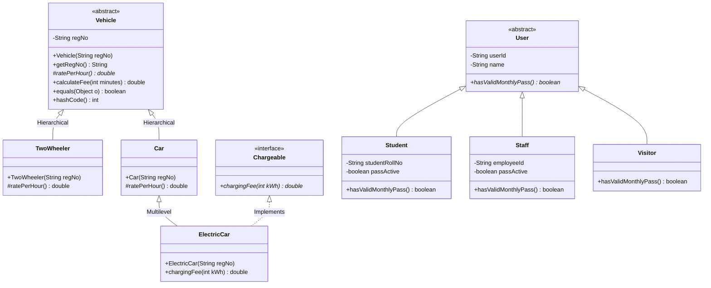

# Task 6: Inheritance Hierarchy

## 1. Inheritance Hierarchy Design

The smart parking system employs two specialized hierarchies: **Vehicle Hierarchy** and **User/Pass Hierarchy**.

### 1. Types of Inheritance Used:
- **Hierarchical Inheritance**: Superclass `Vehicle` branches into `TwoWheeler` and `Car`.
- **Multilevel Inheritance**: Superclass `Vehicle` $\rightarrow$ Subclass `Car` $\rightarrow$ Subclass `ElectricCar`.
- **Multiple Interface Inheritance**: `ElectricCar` extends `Car` and implements `Chargeable`.



---

## 2. Inherited vs. Added Fields and Methods

| Class | Inherited from Superclass | Newly Added in Subclass |
| :--- | :--- | :--- |
| `Vehicle` | `java.lang.Object` (`toString`, `equals`, etc.) | `regNo`, `getRegNo()`, `ratePerHour()`, `calculateFee(int)` |
| `TwoWheeler` | `regNo`, `getRegNo()`, `calculateFee(int)`, `equals`, `hashCode` | Overrides `ratePerHour()` to return Rs 10.0 |
| `Car` | `regNo`, `getRegNo()`, `calculateFee(int)`, `equals`, `hashCode` | Overrides `ratePerHour()` to return Rs 30.0 |
| `ElectricCar` | Everything from `Car` and `Vehicle` | Implements `Chargeable` contract: `chargingFee(int kWh)` (Rs 12/kWh) |

---

## 3. Explicit Use of `super` Keyword

1. **`super(...)` for Constructor Chaining**:
   - Subclass constructors do not inherit superclass constructors.
   - Subclasses must invoke superclass constructors as their very first statement:
     ```java
     class Car extends Vehicle {
         public Car(String regNo) {
             super(regNo); // Passes regNo up to Vehicle's constructor
         }
     }
     ```
2. **`super.methodName()`**:
   - Invokes superclass implementations when overriding, or accesses shadowed methods.

---

## 4. Constructor Execution Order Trace for `ElectricCar`

When executing `new ElectricCar("TN03C3", 45.0)`:
1. `java.lang.Object` constructor is invoked at the root of the hierarchy.
2. `Vehicle(String regNo)` constructor executes: assigns `this.regNo = "TN03C3"`.
3. `Car(String regNo)` constructor executes: runs initialization logic for `Car`.
4. `ElectricCar(String regNo, double batteryCapacity)` constructor body executes: assigns battery capacity and finishes instantiation.

---

## 5. Alternative Concept and Complexity Analysis

### Comparison: Inheritance (`Car is-a Vehicle`) vs Composition (`Vehicle has-a VehicleType`)

#### Composition Design:
Instead of subclassing, a single concrete `Vehicle` class has a reference to a `VehicleType` helper object:
```java
class VehicleType {
    private final String typeName;
    private final double hourlyRate;
    private final boolean isElectric;
    // Constructor, getters...
}

class Vehicle {
    private final String regNo;
    private final VehicleType type; // HAS-A relationship

    public double calculateFee(int minutes) {
        int hours = (minutes + 59) / 60;
        return hours * type.getHourlyRate();
    }
}
```

#### Comparison Matrix:

| Evaluation Dimension | Inheritance (`is-a`) | Composition (`has-a`) |
| :--- | :--- | :--- |
| **Adding New Vehicle Type** | Requires authoring a new subclass (`class Bus extends Vehicle`). Enforces compile-time polymorphism. | Instantiates a new `VehicleType` configuration or enum without new Java classes. Dynamic. |
| **Fee Calculation Time** | **$O(1)$ direct virtual method table (vtable) dispatch**. | **$O(1)$ with extra memory dereference** (`vehicle.type.getHourlyRate()`). |
| **Space per Vehicle Object** | **Header (16B) + 1 reference (`regNo`: 8B) = 24 bytes**. | **Header (16B) + 2 references (`regNo`, `type`: 16B) + `VehicleType` object = 32–48 bytes**. |
| **Type Safety & Behavior** | Highly cohesive. Special vehicle features (like EV charging) are modeled strictly on applicable types via interfaces. | Fragile. All potential attributes must either be lumped into `VehicleType` or managed through nullable fields. |

**Verdict**: Inheritance combined with interfaces (`Chargeable`) is ideal for domain models where subtypes exhibit distinct behavioral capabilities (like EV charging). Composition is advantageous when rates and types are fluid data configured at runtime from databases.
